# Xiaoyang Chen | Shawn

Hi, I'm Xiaoyang Chen, and you can call me Shawn.

I build software and engineering projects.

[Featured projects](#featured-projects) | [GitHub repositories](https://github.com/shawn89890916?tab=repositories)

---

## Featured Projects

### [NavoPath](https://github.com/shawn89890916/NavoPath-planner)

Turn long-term goals into concrete daily action with project trees, a focused daily plan, and timeline-based execution.

`React` | `TypeScript` | `Electron` | `Supabase`

### [Windows Dynamic Island](https://github.com/shawn89890916/windows-dynamic-island)

A customizable Dynamic Island for Windows with music controls, notifications, system tools, and live activity from AI coding sessions.

`Rust` | `TypeScript` | `Tauri`

## Technologies

  

## GitHub Stats

  

  

## Contributions

  <picture>
    <source media="(prefers-color-scheme: dark)" srcset="https://github.com/shawn89890916/shawn89890916/blob/output/github-contribution-grid-snake-dark.svg" />
    <source media="(prefers-color-scheme: light)" srcset="https://github.com/shawn89890916/shawn89890916/blob/output/github-contribution-grid-snake.svg" />
    
  </picture>

Thanks for stopping by.
